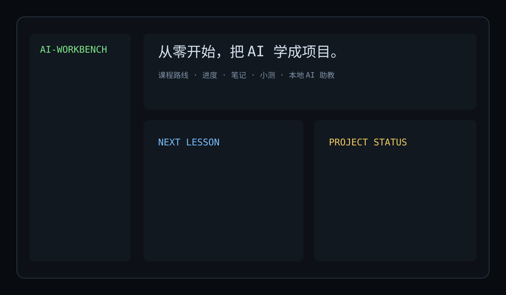

# AI Learning Workbench

一个面向零基础学习者的本地 AI 学习工作台：课程路线、进度、Markdown 笔记、小测、项目实战和 AI 助教集中在一个 Flask 页面里。



## 设计思路

本项目采用“本地精简导学正文 + 外部深度阅读链接”的混合模式：

- 本地保存：学习目标、大白话核心概念、必须掌握的代码/命令、课后小测。
- 外部链接：长篇理论、官方文档、视频课程和进阶资料。
- 独立看板：进度、笔记、自测分数和项目完成状态保存在本地 SQLite。
- AI 助教：通过 Dify 调用本地 Ollama，自动携带当前课程上下文。
- 不复制没有明确许可证的第三方源码；引用信息见 `THIRD_PARTY_NOTICES.md`。

## 12 节种子课

1. 什么是 AI、机器学习和生成式 AI
2. 数据、特征、标签、训练与推理
3. Python 与 AI 开发工具链
4. 向量、相似度与概率直觉
5. 经典机器学习：分类、回归与评估
6. 神经网络与深度学习基础
7. Transformer 与大语言模型
8. Prompt 工程与多轮对话
9. Ollama 本地模型部署与 Python API
10. 文本嵌入、向量检索与 RAG
11. Agent、工具调用与 CodeHarness
12. 综合项目：搭建本地 AI 助手

## 功能

- 总览看板：完成进度、下一课、项目状态。
- 学习路线：4 个阶段、12 节课。
- 课程页：导学正文、代码片段、小测、Markdown 笔记、课程助教。
- 项目实战：链接 Local-AI-Agent、CodeHarness、YOLO-Detection。
- 笔记库：集中查看本地笔记。
- AI 助教：通过 Dify 聊天接口调用 Ollama。

## 快速开始

```powershell
git clone https://github.com/lianhongrui555/AI-Learning-Workbench.git
cd AI-Learning-Workbench

python -m venv .venv
.\.venv\Scripts\Activate.ps1
pip install -r requirements.txt

Copy-Item .env.example .env
# 编辑 .env，填写 DIFY_TUTOR_API_URL 和 DIFY_TUTOR_API_KEY

python -X utf8 app.py
```

也可以在 Windows 上运行一键启动脚本：

```powershell
.\scripts\start_workbench.ps1
```

浏览器打开：

```text
http://127.0.0.1:5000/
```

如果不配置 Dify 助教 Key，课程、进度、笔记、小测和项目卡片仍然可以使用，只有 AI 助教会返回明确提示。

## AI 助教配置

1. 在 Dify 新建一个聊天应用，例如 `AI学习助教`。
2. 模型供应商选择本地 Ollama，模型可以使用 `qwen2.5:7b` 或更小模型。
3. 把 `dify/system-prompt.md` 放入系统提示词。
4. 在应用 API 访问页面创建 API Key。
5. 修改 `.env`：

```text
DIFY_TUTOR_API_URL=http://localhost/v1/chat-messages
DIFY_TUTOR_API_KEY=你的学习助教APIKey
```

## 目录结构

```text
AI-Learning-Workbench/
├─ app.py
├─ content_loader.py
├─ content/
│  ├─ curriculum.json
│  ├─ projects.json
│  └─ lessons/*.md
├─ templates/
├─ static/
├─ data/                 # 本地 SQLite，不提交
├─ tests/
├─ docs/
├─ dify/
└─ .github/workflows/
```

## 数据与安全

- `.env` 已被 `.gitignore` 忽略。
- `data/*.db` 已被 `.gitignore` 忽略。
- Dify API Key 只在 Flask 后端读取，不会发送给浏览器。
- 第一版仅面向个人本机和局域网使用，没有登录和多用户系统。

## 开发与测试

```powershell
python -m unittest discover -s tests -v
python scripts/check_content.py
```

## 许可证

本项目使用 MIT License。课程结构和外部链接参考信息见 [THIRD_PARTY_NOTICES.md](THIRD_PARTY_NOTICES.md)。